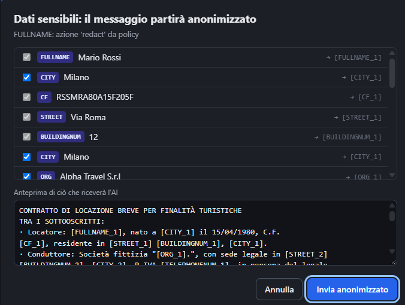
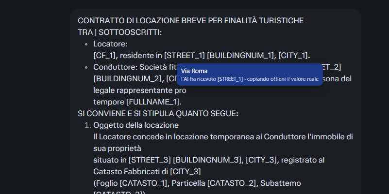
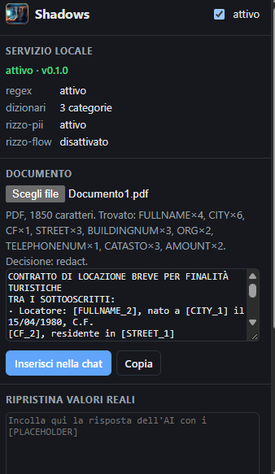
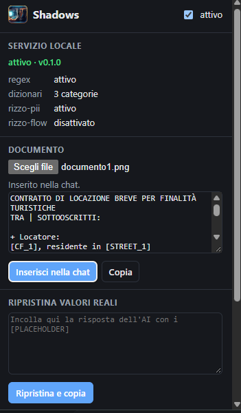
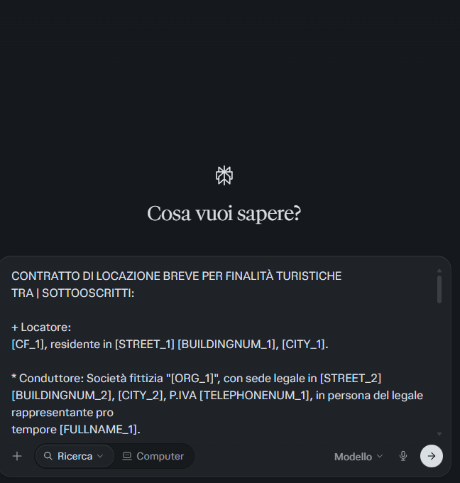

<p align="center">
  
</p>

<h1 align="center">Shadows</h1>

<p align="center">
  <b>Anonimizzazione locale dei dati sensibili prima che arrivino a ChatGPT, Claude, Perplexity &amp; co.</b><br>
  I valori reali non lasciano il tuo computer: l'AI riceve <code>[CLIENTE_1]</code>, tu rileggi "SuperMercati Bianchi".
</p>

---

Chi lavora con le AI in chat incolla di continuo nomi di clienti, codici fiscali,
IBAN, importi di contratti. Shadows si mette **tra il browser e la chat**: intercetta
il messaggio prima dell'invio, trova i dati sensibili, li sostituisce con segnaposto
reversibili e, quando l'AI risponde, ti permette di rileggere e copiare il testo con
i valori veri. Tutto in locale: nessun testo viene mandato a terzi per essere analizzato.

```
Tu scrivi:       Mario Rossi, p.iva IT3823782372743, chiede il pagamento della fattura 23255
L'AI riceve:     [FULLNAME_1], p.iva [PIVA_1], chiede il pagamento della fattura [DOCID_1]
L'AI risponde:   Gentile [FULLNAME_1], in merito alla fattura [DOCID_1]...
Tu copi:         Gentile Mario Rossi, in merito alla fattura 23255...
```

Progetto open source di *Generative AI Data Leakage Prevention*.

## Shadows in azione

Su Perplexity, con un contratto di locazione di prova (tutti i dati sono di fantasia).

**1. Prima dell'invio, Shadows mostra cosa ha trovato.** Le categorie imposte dalla
policy (nomi, codice fiscale, indirizzo) sono bloccate; quelle facoltative, come città
e aziende, si possono lasciare in chiaro togliendo la spunta. Sotto, l'anteprima di
ciò che riceverà l'AI.

<p align="center">
  
</p>

**2. All'AI arrivano solo i segnaposto, ma tu vedi i valori veri.** Passando il mouse
su un segnaposto compare il valore reale, in un riquadro che la pagina non può
leggere; copiando il testo si ottengono i valori reali.

<p align="center">
  
</p>

**3. Documenti, anche scansionati.** Dal popup si carica un PDF o una foto: il testo
viene estratto (con OCR per le scansioni), anonimizzato e inserito nella chat.

<table align="center">
  <tr>
    <td align="center"><br><sub>PDF: 1.850 caratteri, entità trovate per categoria</sub></td>
    <td align="center"><br><sub>Immagine scansionata, letta con OCR</sub></td>
  </tr>
</table>

**4. Il documento entra nella chat già anonimizzato.**

<p align="center">
  
</p>

## Indice

- [Shadows in azione](#shadows-in-azione)
- [Funzionalità](#funzionalità)
- [Come funziona](#come-funziona)
- [Installazione](#installazione)
- [Uso](#uso)
- [Configurazione](#configurazione)
- [Sicurezza del design](#sicurezza-del-design)
- [Verifiche](#verifiche)
- [Limiti noti](#limiti-noti)
- [Struttura del progetto](#struttura-del-progetto)
- [Crediti e licenze](#crediti-e-licenze)

## Funzionalità

- **Intercetta l'invio** su ChatGPT, Claude, Perplexity, Gemini, Mistral e Copilot
  (tasto Invio, pulsante, form) e mostra cosa è stato trovato prima che parta.
- **Rileva** dati personali e commerciali italiani:
  - con regole deterministiche validate da checksum: codice fiscale (anche omocodico),
    partita IVA, IBAN (mod-97), carte di credito (Luhn), email, telefoni, IP, importi
    in euro;
  - con regole di contesto: **chiavi API** (formati noti come `sk-…`, `AKIA…`, `ghp_…`,
    oppure qualsiasi valore annunciato da "API key", "secret", "token"…), **password**
    e PIN (anche senza i due punti: "con password Estate2026!"), **date di nascita**
    ("nato a Pisa il 4/10/2002", "data di nascita: …"). Le altre date restano in chiaro;
  - con il modello NER **[rizzo-pii](https://huggingface.co/rizzoaiacademy/rizzo-pii-0.3B)**:
    nomi, indirizzi, città, aziende, numeri di fattura, documenti d'identità, targhe,
    dati catastali;
  - con **dizionari aziendali**: i clienti, fornitori e progetti riservati che nessun
    modello può conoscere.
- **Policy leggibile** in YAML: per ogni categoria si decide se lasciar passare,
  avvisare, anonimizzare o bloccare.
- **Segnaposto reversibili e coerenti**: lo stesso valore riceve sempre lo stesso
  segnaposto, anche tra messaggi diversi della stessa conversazione.
- **Valori reali solo per te**: al passaggio del mouse e nella copia (Ctrl+C o
  pulsante "copia" della chat), mai nella pagina, dove gli script del sito li leggerebbero.
- **Documenti**: PDF, Word, testo, PDF scansionati e foto (OCR con Tesseract),
  anonimizzati e inseriti nella chat come testo.
- **Guardia di rete**: se l'app di chat prova a inviare un valore protetto per un'altra
  via (copia interna del testo, telemetria), viene sostituito al volo.
- **Tutto in locale**, su CPU: circa 130 ms per prompt, nessuna GPU richiesta.
- **Nessuna porta e nessuna finestra**: è il browser ad avviare Shadows e a parlarci
  via native messaging; chiuso il browser, Shadows si chiude.

## Come funziona

```
 Browser (estensione Shadows)                  Shadows, avviato dal browser
 ────────────────────────────                  (native messaging: canale privato, nessuna porta)
                                               ─────────────────────────────────────────
 1. Invio intercettato ────── testo ─────────► 2. Rilevamento
    (Invio, pulsante, form)                       a. regex + checksum italiani
                                                  b. dizionari aziendali
                                                  c. motore rizzo-pii (NER)
                                               3. Policy YAML → allow/warn/redact/block
 4. Dialogo: cosa è stato trovato,  ◄───────── 4. testo anonimizzato + mappa
    anteprima, scelta dell'utente
 5. Testo sostituito nell'editor e inviato ──► all'AI arrivano solo i segnaposto
    + guardia di rete sulle richieste in uscita
 6. Risposta: valore reale al passaggio del mouse e nella copia
```

**Principio di progetto:** i modelli producono *segnali*, la decisione la prende una
policy deterministica. Ogni blocco è spiegabile ("bloccato perché conteneva SECRET").

### Native messaging: nessuna porta, nessuna finestra

Estensione e motore non comunicano attraverso la rete. Shadows è registrato presso
Chrome ed Edge come *native messaging host*: è il browser ad avviarlo quando si apre
e a chiuderlo quando si chiude, e i due si parlano attraverso un canale privato
(stdin/stdout del processo). Solo l'estensione con l'ID autorizzato può collegarsi:
lo verifica il browser, e Shadows ricontrolla l'origine all'avvio.

- **Nessuna porta aperta**: nessun altro programma o sito può interrogare Shadows.
- **Nessuna finestra da tenere aperta**: niente avvio manuale né avvio automatico di Windows.
- **Modello già pronto**: l'estensione apre il canale all'avvio del browser, così
  Shadows carica il modello (circa 15 secondi) prima che serva.
- **Nessun processo orfano**: chiuso il browser, il canale si chiude e Shadows termina.

L'ID dell'estensione è fisso (`alngggpijcifihhaiinffieicpahopnh`) grazie alla chiave
pubblica nel manifest: non dipende dalla cartella da cui la si carica.

### Le azioni della policy

| Azione | Cosa succede | Esempio di default |
|---|---|---|
| `allow` | il messaggio parte così com'è | date (tranne quelle di nascita) |
| `warn` | l'utente vede cosa è stato trovato e sceglie: anonimizzato, originale o solo alcuni valori | importi, aziende generiche, città |
| `redact` | il messaggio può partire solo anonimizzato | nomi, CF, IBAN, clienti, password, date di nascita |
| `block` | il messaggio non parte | chiavi API e segreti tecnici (vanno ruotati, non inviati) |

La decisione finale è la più severa tra l'azione delle categorie trovate e la soglia
raggiunta da un punteggio di rischio (somma dei pesi dei valori distinti).

### Tre difese nel browser

Emerse dai test sui siti reali; ognuna copre un caso che le altre non coprono.

1. **Intercettazione all'invio.** Il testo nell'editor viene sostituito con quello
   anonimizzato. Se l'editor non accetta la sostituzione, l'invio viene annullato:
   meglio non inviare che inviare in chiaro.
2. **Guardia di rete** ([`extension/guard.js`](extension/guard.js)). Alcune app inviano
   una copia del testo presa dal proprio stato interno, che può essere quella
   *precedente* alla sostituzione: una race condition osservata su Perplexity. La
   guardia ispeziona `fetch`, `XMLHttpRequest`, `WebSocket` e `sendBeacon` e sostituisce
   i valori protetti prima che partano.
3. **Blocco dei canali delle bozze** ([`extension/rules.json`](extension/rules.json)).
   Perplexity invia la bozza *lettera per lettera mentre si scrive* (circa 50 frame
   WebSocket per frase) per i suggerimenti di completamento, prima di qualunque invio.
   ChatGPT, con l'utente collegato, invia il testo della casella a ogni pausa
   (`backend-api/f/conversation/prepare`, campo `partial_query`) per preparare in
   anticipo la risposta. Nessun controllo "all'invio" può fermare questi flussi: i due
   canali sono bloccati con `declarativeNetRequest`.

### Valori reali nelle risposte

| Modalità (popup) | Comportamento |
|---|---|
| **sicura** (default) | la pagina mostra i segnaposto; il valore reale compare passando il mouse, in un riquadro in shadow DOM chiuso che la pagina non può leggere; copiando si ottengono i valori reali |
| dentro la pagina | i segnaposto vengono sostituiti nel testo della pagina. Più comodo, ma gli script del sito (telemetria, registrazione delle sessioni) li leggono: nei test su Perplexity la guardia ha dovuto ripulire centinaia di richieste |
| mai | solo segnaposto |

C'è anche un riquadro nel popup in cui incollare qualsiasi testo con segnaposto e
ottenerlo convertito.

## Installazione

Requisiti: Windows (testato su Windows 11), Python 3.11+, Chrome o Edge.

```bash
git clone https://github.com/deros92/shadows.git
cd shadows
python -m venv .venv
.venv\Scripts\activate
pip install torch --index-url https://download.pytorch.org/whl/cpu
pip install -r requirements.txt
```

**Quale Python usano gli script.** I comandi qui sopra creano la cartella `.venv`:
un ambiente Python riservato a Shadows. Gli script `.cmd` la trovano da soli, quindi
seguendo questi passi non c'è altro da fare.

Se hai già le librerie in un altro ambiente (per esempio conda) e non vuoi creare la
`.venv`, indica agli script quale `python.exe` usare con la variabile d'ambiente
`SHADOWS_PYTHON`, poi apri un nuovo terminale:

```bat
setx SHADOWS_PYTHON "C:\Users\<utente>\miniconda3\envs\<ambiente>\python.exe"
```

Ordine di ricerca: `SHADOWS_PYTHON`, poi la `.venv` del progetto, poi il `python` del
sistema. Il Python scelto al momento della registrazione è anche quello che userà il
browser per avviare Shadows: se lo cambi, rilancia `installa-shadows.cmd`.

**Registrazione presso il browser (una volta sola):** doppio clic su
[`installa-shadows.cmd`](installa-shadows.cmd), oppure `python -m shadows install-native`.
Scarica il modello rizzo-pii da Hugging Face (circa 1,2 GB, in `models/`; da lì in poi
tutto funziona offline) e registra Shadows per Chrome ed Edge nella parte di registro
dell'utente, senza permessi di amministratore. Per annullare:
`python -m shadows uninstall-native`.

**Estensione:**
1. apri `chrome://extensions` (o `edge://extensions`) e attiva la *Modalità sviluppatore*;
2. *Carica estensione non pacchettizzata* → seleziona la cartella **`extension`**;
3. chiudi del tutto il browser e riaprilo.

Da qui in poi non c'è niente da avviare: aprendo il browser parte anche Shadows. Il
popup dell'estensione mostra "canale privato" quando il collegamento è attivo.

**Modalità sviluppatore.** Un'estensione caricata da una cartella funziona solo con la
modalità sviluppatore attiva: se la si spegne, il browser disattiva Shadows. Il rischio
è trascurabile (la modalità permette di caricare estensioni da cartella, ma solo con
un'azione esplicita dell'utente). Per farne a meno, gratuitamente:

| Strada | Note |
|---|---|
| [Microsoft Edge Add-ons](https://partner.microsoft.com/dashboard/microsoftedge/) | gratuito, con revisione di Microsoft; pubblicabile come estensione *nascosta*, installabile solo da chi ha il link. Richiede di adottare la chiave assegnata dallo store e di rifare `install-native` |
| PC aziendali gestiti | l'IT installa il pacchetto con i criteri del browser (vedi [Distribuzione in azienda](#distribuzione-in-azienda)) |

Sui PC Windows personali, non gestiti da un'azienda, Chrome rifiuta le estensioni
esterne allo store anche se imposte con i criteri. Il Chrome Web Store richiede una
quota di registrazione una tantum.

**Modalità demo (porta locale).** [`avvia-shadows.cmd`](avvia-shadows.cmd), ovvero
`python -m shadows serve`, avvia invece un servizio su `127.0.0.1:8765`: serve per la
pagina **http://127.0.0.1:8765/demo** (una finta chat che mostra cosa riceverebbe
davvero l'AI) e per i test. Se Shadows non è registrato presso il browser,
l'estensione ripiega su questa porta.

**OCR (facoltativo)**, per PDF scansionati e foto:

```bash
winget install --id UB-Mannheim.TesseractOCR -e
pip install pytesseract
mkdir tessdata
curl -L -o tessdata/ita.traineddata https://github.com/tesseract-ocr/tessdata_best/raw/main/ita.traineddata
curl -L -o tessdata/eng.traineddata https://github.com/tesseract-ocr/tessdata_best/raw/main/eng.traineddata
```

I modelli linguistici stanno nella cartella del progetto: non servono permessi di
amministratore per aggiungere l'italiano.

## Uso

**In chat:** scrivi normalmente e premi Invio. Se ci sono dati sensibili compare un
dialogo con l'elenco di cosa è stato trovato e l'anteprima di cosa riceverà l'AI.
Le categorie facoltative (per esempio gli importi) si possono lasciare in chiaro
togliendo la spunta.

**Documenti:** icona di Shadows → *Documento* → scegli il file → *Inserisci nella
chat*. Non allegare i file direttamente alla chat: arriverebbero interi all'AI.
Shadows lo segnala e, se attivato nel popup, lo blocca.

**Da riga di comando:**

```bash
python -m shadows scan contratto.pdf          # stampa il testo anonimizzato
python -m shadows scan foto.jpg --json        # decisione, motivi e mappa in JSON
echo "IBAN IT60X0542811101000000123456" | python -m shadows scan -
```

## Configurazione

Tutto in [`config/policy.yaml`](config/policy.yaml): pesi e azioni per categoria,
soglie, dizionari, modalità del motore rizzo-pii, audit.

### Dizionari aziendali

Un modello NER riconosce i *dati personali*, ma non può sapere che "Caseificio
Valpadana" è un fornitore con condizioni riservate o che "Volantino Natale 2026" è
un'iniziativa non ancora pubblica: lo sa solo l'azienda. I dizionari sono elenchi di
questi termini, uno per riga (`#` per i commenti):

| File | Etichetta | Esempio |
|---|---|---|
| `config/dizionari/clienti.txt` | `CLIENTE` | SuperMercati Bianchi |
| `config/dizionari/fornitori.txt` | `FORNITORE` | Caseificio Valpadana |
| `config/dizionari/progetti.txt` | `PROGETTO` | Volantino Natale 2026 |

```
Tu scrivi:    prepara una mail per Caseificio Valpadana sul Volantino Natale 2026
L'AI riceve:  prepara una mail per [FORNITORE_1] sul [PROGETTO_1]
```

Il riconoscimento ignora maiuscole e spazi multipli e non scatta su pezzi di parola.
In caso di sovrapposizione il dizionario prevale sul modello: un cliente che il
modello vede come generica azienda (`ORG`, solo avviso) diventa `CLIENTE` e viene
anonimizzato per forza. Altre categorie si aggiungono nella sezione `dizionari` della
policy.

**Nomi veri fuori da Git.** I `.txt` del repository contengono solo nomi inventati.
I nomi reali vanno in un file con lo stesso nome e suffisso `.local.txt` (per esempio
`clienti.local.txt`): Shadows legge entrambi, `.gitignore` esclude sempre i
`.local.txt`. Pubblicare l'elenco dei clienti sarebbe proprio la fuga di dati che
Shadows deve impedire.

**Motore rizzo-pii.** `mode: integrato` (default) carica il modello dentro Shadows.
`mode: servizio` usa invece un'app rizzo-pii già avviata a parte (desktop o Docker).

### Operazioni del motore

Le stesse operazioni ([`shadows/service.py`](shadows/service.py)) sono esposte su due
canali: messaggi JSON via native messaging (uso quotidiano) e HTTP su 127.0.0.1
(modalità demo).

| Messaggio native | HTTP | Uso |
|---|---|---|
| `health` | `GET /health` | stato e rilevatori attivi; durante l'avvio risponde `loading` |
| `analyze` | `POST /v1/analyze` | `{text, site?, known_mapping?}` → decisione, entità, testo anonimizzato, mappa |
| `document` | `POST /v1/document` | file (base64 nel messaggio, upload in HTTP) → come sopra, più i dati del documento |
| `restore` | `POST /v1/restore` | `{text, mapping}` → testo con i valori reali |
| `event` | `POST /v1/event` | esito della scelta dell'utente, per l'audit |
| — | `GET /demo` | pagina di prova |

Le risposte native oltre 1 MB (limite del browser) vengono spezzate in parti e
ricomposte dall'estensione.

## Sicurezza del design

- **Nessuna porta di rete** nell'uso quotidiano: il canale native è accessibile solo
  all'estensione con l'ID autorizzato, verificato dal browser e ricontrollato da Shadows.
- La registrazione è nella parte di registro **dell'utente** (`HKCU`), senza permessi
  di amministratore. In azienda va fatta per tutto il PC (`HKLM`) e con Shadows in una
  cartella protetta: un programma che gira con i permessi dell'utente non potrebbe
  così far puntare il browser a un "falso Shadows".
- In modalità demo il servizio HTTP ascolta **solo su 127.0.0.1**, rifiuta richieste
  con `Host` diverso da localhost (difesa dal DNS rebinding) e con `Origin` di un sito
  web: una pagina qualsiasi non può usarlo dal tuo browser.
- Il **registro di audit** (`logs/audit.jsonl`) contiene solo metadati: azione,
  categorie, conteggi, scelta dell'utente. Mai testo, valori o identità.
- La **mappa** segnaposto → valore vive in `chrome.storage.session`: in memoria,
  cancellata alla chiusura del browser, mai inviata ai siti.
- Il modello si scarica **senza file pickle** (`training_args.bin` escluso): solo pesi
  `safetensors`, configurazione e tokenizer.
- Nessuna dipendenza AGPL: i PDF si leggono con pdfplumber (MIT), non con PyMuPDF.

## Verifiche

```bash
python -m pytest -q                            # 56 test: motore, API, native, documenti, OCR, modello
python tools/check_native.py                   # native messaging in un browser vero
python tools/check_sites.py demo perplexity    # end-to-end con Playwright (modalità demo)
python tools/check_drafts.py perplexity --ext  # la bozza esce prima dell'invio?
```

Risultati del 2026-10-18:

| Verifica | Esito |
|---|---|
| Native messaging in un browser vero | ID dell'estensione corretto; Shadows avviato dal browser e pronto in ~16 s; porta 8765 chiusa prima e durante l'uso; chiuso il browser, Shadows termina |
| Motore integrato vs app rizzo-pii originale (4 testi, incluso uno da 2.000 caratteri a blocchi) | entità identiche, stesse posizioni |
| Perplexity reale, invii ripetuti con mouse e tasto Invio | in rete solo segnaposto in tutti gli invii |
| Bozza di Perplexity durante la scrittura | 49–55 frame in chiaro senza Shadows, 0 con Shadows |
| Copia della risposta (Ctrl+C e pulsante "Copia") | valori reali negli appunti |
| PDF di contratto → riassunto → copia | segnaposto all'AI, valori reali nel riassunto copiato |
| ChatGPT, Claude | provati a mano; non automatizzabili (Cloudflare, login) |

## Limiti noti

### Installazione e uso quotidiano

Shadows è un progetto, non ancora un prodotto pronto per chiunque. Oggi:

- **Serve Python.** Tutto il riconoscimento avviene nel motore Python: l'estensione da
  sola non anonimizza nulla. Bisogna installare Python 3.11+, PyTorch e le dipendenze
  (vedi [Installazione](#installazione)). Non esiste ancora un installer `.exe`.
- **Senza motore non c'è protezione.** Se il motore non è installato o non risponde,
  all'invio compare l'avviso "servizio non raggiungibile" e l'utente sceglie se inviare
  il messaggio **senza controllo** o annullare. Dal popup si può impostare il blocco
  (`closed`) oppure l'invio con un semplice avviso (`open`). Nessun dato parte di
  nascosto, ma nemmeno viene anonimizzato.
- **Download pesante.** Il modello rizzo-pii occupa circa 1,2 GB, più PyTorch; per
  documenti scansionati e foto serve anche Tesseract.
- **Primo avvio lento.** Il modello si carica in circa un minuto quando il browser
  avvia il motore; dopo, ogni prompt richiede circa 130 ms su CPU.
- **Estensione in modalità sviluppatore.** Shadows non è sul Chrome Web Store né su
  Edge Add-ons: si carica come estensione "non pacchettizzata" e funziona solo con la
  modalità sviluppatore attiva. Il browser può mostrare un avviso all'avvio. In
  azienda si evita con la [distribuzione gestita](#distribuzione-in-azienda).
- **Solo Windows.** La registrazione del native messaging usa il registro di Windows
  (testato su Windows 11). La modalità demo HTTP non dipende dal sistema, ma non è
  pensata per l'uso quotidiano.
- **Solo Chrome ed Edge.** Firefox e Safari non sono supportati.
- **Solo i siti elencati.** Shadows è attivo solo sui siti dichiarati nel
  [manifest](extension/manifest.json): ChatGPT, Claude, Perplexity, Gemini, Mistral e
  Copilot. È verificato su ChatGPT, Claude, Perplexity e Gemini. Mistral e Copilot
  usano selettori generici e non sono stati verificati. Le app desktop delle AI e gli
  altri siti non sono coperti.
- **Aggiornamenti manuali.** Non c'è aggiornamento automatico: dopo una modifica al
  motore si chiude e riapre il browser, dopo una modifica all'estensione la si ricarica
  da `chrome://extensions`.

### Cosa Shadows non può fermare

Shadows riduce gli errori **involontari**; non ferma chi vuole esfiltrare dati di
proposito.

- **Aggiramenti banali**: Base64, testo spezzato su più messaggi, traduzione,
  screenshot, telefono personale.
- **Allegati diretti** alla chat: segnalati o bloccati, non anonimizzati.
- **Canali delle bozze**: bloccati solo quelli noti: Perplexity (bozza lettera per
  lettera) e ChatGPT con login (`conversation/prepare` a ogni pausa). Verificato il
  2026-10-19 che non inviano la bozza mentre si scrive: ChatGPT senza login
  (`tools/check_drafts.py`: la telemetria registra solo che si è iniziato a scrivere) e
  Claude con login (DevTools: solo telemetria con modello, lingua e fuso orario). Non
  verificati: Gemini, Mistral, Copilot. Se un sito cambia l'indirizzo del canale, la
  regola va aggiornata.
- **Interfacce dei siti**: cambiano spesso; i selettori sono in
  [`extension/sites.js`](extension/sites.js).
- **Corpi binari o compressi** e richieste dai Web Worker sfuggono alla guardia di rete:
  per questo il ripristino nella pagina non è il default.
- **Perdita di contesto**: senza un importo l'AI non può valutarne la convenienza.
  Per questo gli importi sono `warn` e si possono lasciare in chiaro.
- **Contesto che identifica**: "il nostro unico cliente caseario di Matera" non contiene
  entità ma identifica.
- **Segreti senza parola chiave**: una chiave con un formato non noto viene riconosciuta
  solo se è annunciata ("API key …", "secret …", "token: …"). Incollata da sola, nuda,
  resta in chiaro. Lo stesso per una data di nascita scritta senza "nato il" o "data di
  nascita".
- **OCR**: un codice fiscale letto male non supera il checksum e non viene anonimizzato.
  Dopo un OCR conviene ricontrollare l'anteprima.
- **Prompt injection**: fuori perimetro. Riguarda le applicazioni LLM aziendali (RAG,
  agenti), non i dipendenti che usano chat esterne.

**Uso in azienda (Italia):** richiede la valutazione dell'art. 4 dello Statuto dei
Lavoratori (controlli a distanza), una DPIA e un'informativa ai dipendenti. Shadows
è pensato per non profilare le persone: il dialogo è per l'utente, l'audit non
contiene identità.

## Distribuzione in azienda

Senza store e senza costi, con gli strumenti che l'IT usa già:

1. **Estensione**: si impacchetta in un `.crx` firmato con la chiave privata
   dell'estensione (generata da [`tools/make_extension_key.py`](tools/make_extension_key.py),
   esclusa dal repository) e la si pubblica su un server interno con il suo file di
   aggiornamento. Il criterio `ExtensionInstallForcelist` di Chrome/Edge (Group Policy o
   Intune) la installa su tutti i PC gestiti, senza che l'utente possa disattivarla.
   Un'azienda che usa una propria chiave deve aggiornare `key` nel manifest e
   `allowed_origins` del host.
2. **Motore**: si installa con il sistema di distribuzione software aziendale, in una
   cartella protetta, registrando il host per tutto il PC (`HKLM`).
3. **Scappatoie**: criteri per forzare l'estensione anche in incognito (o disattivarlo)
   e per limitare i browser non gestiti. Le app desktop delle AI e i dispositivi non
   gestiti restano compito dei controlli di rete (SSE/CASB): Shadows è il livello
   vicino all'utente, non l'unico.

## Struttura del progetto

```
shadows/                    servizio Python
  __main__.py               riga di comando: install-native, native, serve, scan
  service.py                operazioni del motore, comuni ai due canali
  native_host.py            canale native messaging (avviato dal browser)
  native_install.py         registrazione presso Chrome ed Edge, ID dell'estensione
  server.py                 canale HTTP su 127.0.0.1 (demo, test) e controlli Host/Origin
  engine.py                 pipeline: rilevatori → sovrapposizioni → policy → anonimizzazione
  detectors/regex_it.py     regex e checksum italiani
  detectors/dictionary.py   dizionari aziendali (+ .local.txt)
  detectors/rizzo_local.py  motore rizzo-pii integrato (download e caricamento del modello)
  detectors/rizzo_pii.py    rizzo-pii come servizio HTTP esterno (facoltativo)
  vendor/rizzo_pii/         motore di rizzo-pii (MIT, Simone Rizzo)
  entities.py               entità e risoluzione delle sovrapposizioni
  policy.py                 decisione deterministica
  anonymizer.py             segnaposto reversibili e ripristino
  documents.py              PDF, DOCX, testo, OCR
  audit.py                  registro di soli metadati
  static/demo.html          chat di prova
extension/                  estensione Chrome/Edge (Manifest V3)
  content.js                intercettazione, dialogo, ripristino
  guard.js                  guardia di rete (contesto della pagina)
  rules.json                blocco dei canali delle bozze
  background.js             canale native (con ripiego HTTP), mappa in memoria
  popup.html, popup.js      stato, documenti, ripristino, impostazioni
  sites.js                  selettori dei siti di chat
config/                     policy e dizionari d'esempio
tests/                      pytest
tools/                      verifiche end-to-end, chiave dell'estensione, icone
installa-shadows.cmd        registrazione presso il browser (una volta sola)
avvia-shadows.cmd           modalità demo sulla porta 127.0.0.1:8765
```

## Crediti e licenze

Shadows è distribuito con licenza **MIT** ([LICENSE](LICENSE)).

Il riconoscimento di nomi, indirizzi e documenti si basa su
**[rizzo-pii](https://github.com/Rizzo-AI-Academy/rizzo-pii)** di **Simone Rizzo —
Rizzo AI Academy** (MIT): il modello
[rizzoaiacademy/rizzo-pii-0.3B](https://huggingface.co/rizzoaiacademy/rizzo-pii-0.3B)
e parte del suo motore, inclusa in [`shadows/vendor/rizzo_pii/`](shadows/vendor/rizzo_pii/).
Il modello è basato su [mmBERT-base](https://huggingface.co/jhu-clsp/mmBERT-base) (MIT).

Elenco completo delle dipendenze e delle licenze in
[THIRD_PARTY_NOTICES.md](THIRD_PARTY_NOTICES.md).
